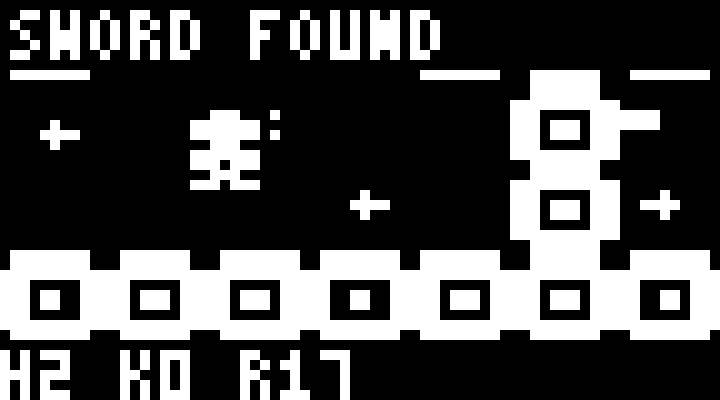

# ESP32-C3 Arduboy Zelda-style Adventure

[한국어](README.md) · [User guide / 사용 가이드](USER_GUIDE.md) · [Porting notes](PORTING.md)

An independent repository porting an Arduboy-style top-down adventure for the ESP32-C3 mini's **0.42-inch, 72×40, 1-bit OLED**. The requested repository name is `esp32c3-arduboyzelda`. This is not Nintendo's Zelda or an NES emulator.

**Pocket Quest is an experimental playable port.** The ESP32 compatibility layer, original art, native 72×40 HUD/menus and controller mode have passed real-board checks. Pocket World's original mini dungeon remains a separate mode.

**2026-11-11 inventory fix:** All three slots can be browsed even with no secondary items. `-` marks unowned gear and `B` marks equipped gear; unowned gear cannot be equipped. [Screen and verification](verification/README.md).

## Selected source

The source material is [Ardynia](https://github.com/Pharap/ardynia), originally by Matt Greer, pinned to revision `e07fafd1d076481c6fe3c0f85695c98e2dc976d6`. It targets the 128×64 Arduboy and includes game logic, entities, maps and inventory code.

Its license distinguishes **MIT code from restricted graphics**. Original sprite, tile and font images and audio are excluded. Newly authored patterns in `tools/make_assets.py` generate replacement graphics; the platform sound interface is silent.

## Included material

- `vendor/ardynia/src/`: Unmodified MIT C++ source at the pinned revision, including remaining AVR dependencies.
- `vendor/ardynia/LICENSE`: Full original terms, including the graphics restriction and MIT license.
- `tools/prepare_sources.py`: Code import/verification tool that excludes graphics and audio files.
- `UPSTREAM_MANIFEST.json`: Revision, exclusion list and per-file SHA256 hashes.
- `src/`: ESP32 port, input/NVS compatibility, new renderer and artwork.
- `tools/assemble_port.py`: Reapplies adaptations while preserving the original snapshot.
- `firmware/ArduboyQuest/`: Standalone USB/OLED firmware.
- `PORTING.md`: Implementation notes and verification scope.

Build `src/`, not the archival `vendor/` snapshot. The original 128×64 logical coordinates are retained. The 112×64 playfield is sampled into 72×34; the bottom six rows and menus use native-resolution lettering.



## Build and verification

```powershell
python tools/prepare_sources.py --check
python tools/check_maps.py
./tools/build.ps1
```

2026-11-10: verified all 106 compressed rooms, movement/room transitions, sword pickup/attack, inventory, live view OFF/ON, lock/heartbeat pause, saved progress after reboot and integrated Doom switching. See [verification scope](verification/README.md).

Requires Arduino CLI, ESP32 Arduino core 3.1.1 and Python 3.10+. SSD1306 wiring is SDA5/SCL6, address 0x3C. Upload standalone firmware with `python tools/flash.py --port COM4`. Use the [parent integrated firmware](https://github.com/despild/esp32-micro-world/tree/main/esp32c3mini-oled0.42-72x40) to retain pet and Doom modes.

Controls: arrows/WASD move, Ctrl/Z sword/confirm, Space secondary item, Enter/Tab inventory/map. The sword chest is two rooms right of the start; approach from below. Item/room progress is stored in the separate `ard-quest` NVS namespace; restarts begin at the region entrance. A complete playthrough has not been verified.

New port code and tools are MIT-licensed; imported code retains the original MIT terms. This project is unaffiliated with Nintendo and includes no Nintendo ROMs or assets.
