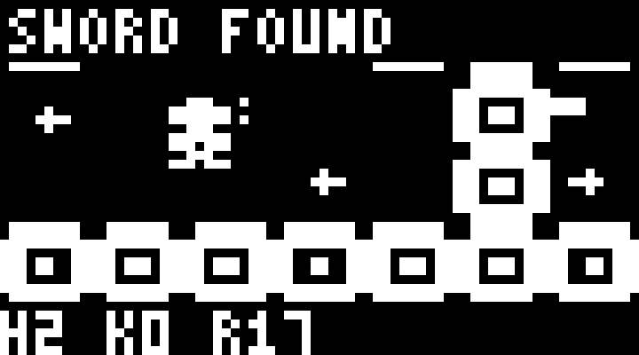

# ESP32-C3 Arduboy Zelda-style Adventure

[English](README.en.md) · [사용 가이드 / User guide](USER_GUIDE.md) · [포팅 계획 / Porting notes](PORTING.md)

ESP32-C3 mini의 **0.42인치 72×40 1비트 OLED**에 Arduboy 계열 젤다 스타일 모험 게임을 가져오기 위한 독립 저장소입니다. 저장소 이름은 요청한 `esp32c3-arduboyzelda`를 사용합니다. 닌텐도 원작 젤다나 NES 에뮬레이터는 아닙니다.

**Pocket Quest 실험판을 보드에서 플레이할 수 있습니다.** ESP32 호환 계층, 자체 그래픽, 72×40 HUD·메뉴와 컨트롤러 모드를 구현하고 실제 보드 검증을 통과했습니다. 기존 Pocket World의 ‘던전’은 별도의 자체 미니 게임입니다.

## 선정한 기반

[Ardynia](https://github.com/Pharap/ardynia)의 C++ 게임 코드를 기반 자료로 보관했습니다. 원작자 Matt Greer, 고정 revision `e07fafd1d076481c6fe3c0f85695c98e2dc976d6`입니다. 원본 대상은 128×64 Arduboy이며, 게임 로직·엔티티·맵·인벤토리 코드를 포함합니다.

원작 라이선스는 **코드 MIT / 그래픽 별도 제한**입니다. 이 저장소는 원본 스프라이트·타일·폰트·음원을 포함하지 않습니다. `tools/make_assets.py`에서 새로 만든 픽셀 패턴을 생성하고 무음 플랫폼 계층을 사용합니다.

## 포함한 자료

- `vendor/ardynia/src/`: 고정 버전의 MIT C++ 게임 코드. 원본 그대로이며 AVR 의존 코드도 남아 있습니다.
- `vendor/ardynia/LICENSE`: 그래픽 제한과 MIT 조항을 포함한 원문 전체.
- `tools/prepare_sources.py`: 원본 그림·소리 관련 파일을 제외하는 소스 가져오기/검증 도구.
- `UPSTREAM_MANIFEST.json`: 원본 revision, 제외 목록, 파일별 SHA256.
- `src/`: ESP32 포트, 입력·NVS 호환 계층, 자체 그리기 코드·에셋.
- `tools/assemble_port.py`: 원본을 보존하면서 플랫폼 수정을 재적용하는 도구.
- `firmware/ArduboyQuest/`: 단독 USB/OLED 펌웨어.
- `PORTING.md`: 구현 내용과 검증 범위.

빌드에는 `src/`를 사용합니다. `vendor/`는 원본 기록이며 직접 빌드하지 않습니다. 게임 좌표는 128×64로 유지하고, 게임 영역 112×64를 72×34로 출력하며 하단 6픽셀과 메뉴는 네이티브 해상도로 그립니다.



## 검증

```powershell
python tools/prepare_sources.py --check
python tools/check_maps.py
./tools/build.ps1
```

2026-11-10: 106개 방 압축 데이터, 이동·방 전환·검 획득/공격·장비 메뉴, 라이브 뷰 OFF/ON, 잠금/연결 단절 일시 정지, 재부팅 후 저장 복원과 통합 Doom 전환을 확인했습니다. [검증 범위](verification/README.md)를 참고하세요.

Arduino CLI, ESP32 Arduino core 3.1.1, Python 3.10+를 사용합니다. SSD1306 핀은 SDA5/SCL6, 주소 0x3C입니다. `python tools/flash.py --port COM4`로 단독 버전을 업로드합니다. 기존 펫·Doom과 함께 사용하려면 [상위 통합 펌웨어](https://github.com/despild/esp32-micro-world/tree/main/esp32c3mini-oled0.42-72x40)를 사용하세요.

방향키/WASD 이동, Ctrl/Z 검·확인, Space 보조 아이템, Enter/Tab 장비·지도입니다. 시작 방에서 오른쪽 두 방의 상자 아래로 접근하면 검을 얻습니다. 아이템·방 진행은 별도 `ard-quest` NVS에 저장하며, 재시작은 지역 입구에서 합니다. 전체 게임 완주는 아직 검증하지 않았습니다.

새 포팅 도구 코드는 MIT, 가져온 코드는 원저작자의 MIT 조건을 따릅니다. 닌텐도와 무관한 모험 게임 포트이며 닌텐도 ROM이나 에셋을 포함하지 않습니다.
