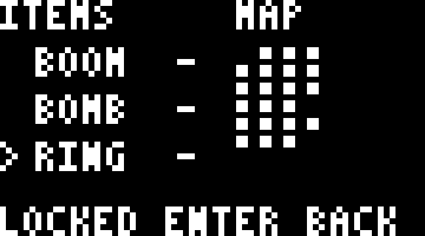

# 검증 / Verification — 2026-11-10

ESP32-C3 4MB, SSD1306 72×40, SDA5/SCL6, Arduino ESP32 core 3.1.1.

| 검사 / Check | 결과 / Result |
|---|---|
| 통합 펌웨어 빌드·실물 업로드 / Integrated build and hardware upload | PASS, app 917,984 bytes |
| 단독 펌웨어 빌드 / Standalone build | PASS, app 382,352 bytes; standalone hardware run not tested separately |
| 압축 맵 / Compressed maps | PASS, 106 rooms × 28 tiles |
| 이동·두 방 전환 / Movement and two room transitions | PASS |
| 검 획득·공격 / Sword pickup and attack | PASS |
| 장비 메뉴 / Inventory menu | PASS |
| 라이브 뷰 OFF 중 입력·게임 유지 / Input and gameplay with readback off | PASS |
| 잠금 일시 정지·재개 / Lock pause and resume | PASS |
| 재부팅 저장 복원 / Save restored after hardware reset | PASS, sword retained at region checkpoint |
| Doom 발사 및 네 모드 / Doom firing and all four integrated modes | PASS |
| 연결 단절 자동 생활 / Heartbeat timeout and resume | PASS |

[플레이 기록 / Gameplay](gameplay.json) · [통합 기록 / Integration](integration.json).

이 결과는 초기 플레이와 통합 검증입니다. 모든 던전·퍼즐·보스 완주는 검증하지 않았습니다. PC 잠금 알림 UI 검사는 앱 자체 창에 이벤트를 주입하며 실제 Windows 잠금은 실행하지 않습니다.

These checks cover initial gameplay and integration, not a full playthrough of every dungeon, puzzle and boss. The controller WTS test injects events into its own window rather than locking Windows.

## 2026-11-11 · 장비 화면 / Inventory 0.1.1

단독 펌웨어를 실제 보드에 올려, 보조 장비 0개 상태에서도 세 슬롯의 커서 이동·길게 누르기·경계 처리·미획득 장착 거부·메뉴 재진입·라이브 뷰 OFF 중 입력을 확인했습니다. 검과 보유 아이템을 유지했으며 저장 초기화나 아이템 지급은 하지 않았습니다. 컴파일 시 빈/일부/전체 보유 상태의 선택 규칙도 검사합니다.

The standalone firmware passed real-board cursor movement, hold repeat, boundaries, locked-item rejection, reopening and navigation with live view off, while owning zero secondary items. Sword/inventory were preserved; no save reset or item granting was used. Compile-time regressions also check selection rules for empty, partial and full inventories.

[USB 결과 / USB results](inventory.json)

